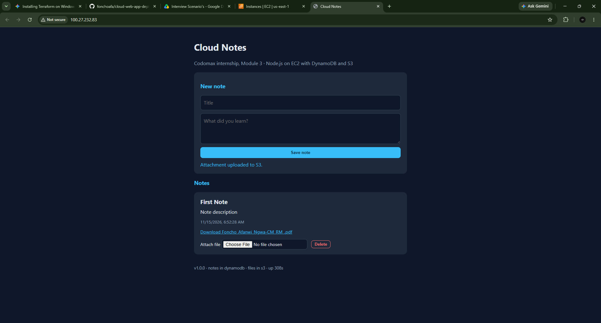

# Cloud Services & Web App Deployment (Module 3)

Codomax Digital Solutions internship, Module 3 (Day 11 to Day 15).
Author: Foncho Afanwi Ngwa ([@fonchoafa](https://github.com/fonchoafa))

This repository deploys a small Node.js web app, **Cloud Notes**, to AWS and documents the cloud services behind it: compute, object storage, a managed database, virtual networking, IAM and monitoring. Everything is created with Terraform and removed with one command.

**Live website:** http://44.212.240.159 (health check: http://44.212.240.159/health)

The site is served over plain HTTP, so browsers show "Not secure". It is a training deployment with no domain or TLS certificate.

## Architecture

```
Browser --HTTP 80--> Security group --> EC2 (Ubuntu 24.04) --> nginx --> Node.js app :3000
                                              |                                |
                                       IAM role (no keys)          +-----------+-----------+
                                              |                    v                       v
                                  CloudWatch logs + metrics   DynamoDB (notes)      S3 (attachments)
                                                              SSM Parameter Store (admin key)
```

| Layer | Service | Purpose |
| --- | --- | --- |
| Compute | EC2 `t3.micro`, Elastic IP, systemd, nginx | Runs the app, limited to 300 MB RAM and 80% CPU |
| Object storage | S3 | Private, encrypted bucket for uploads, 30-day expiry |
| Managed database | DynamoDB (on-demand) | Stores notes |
| Networking | VPC, security group, `ufw` | 80 public, 22 only from my IP, app port not exposed |
| IAM | Instance role | Only the one table, bucket and parameter, no access keys on the server |
| Secrets | SSM Parameter Store (SecureString) | Admin key protecting `DELETE` |
| Monitoring | CloudWatch Logs, metrics, alarms, Budgets | JSON app logs, CPU and status alarms, cost alert by email |

## What is in this repo

| Path | Content |
| --- | --- |
| [app/](app/) | Express app, static front end, 7 automated tests (`npm test`) |
| [terraform/](terraform/) | `main.tf`, `variables.tf`, `outputs.tf`, `user_data.sh.tftpl` |
| [docs/01-cloud-services-exploration.md](docs/01-cloud-services-exploration.md) | Compute, storage, databases, networking, IAM and monitoring explained and explored |
| [docs/02-secrets-config-logging-quotas.md](docs/02-secrets-config-logging-quotas.md) | Environment variables, secrets, application logging and resource quotas |
| [docs/03-deployment-guide.md](docs/03-deployment-guide.md) | Step by step deployment, verification, troubleshooting and clean up |
| [scripts/](scripts/) | `smoke-test.ps1` checks a deployed site |
| [screenshots/](screenshots/) | Evidence from the live deployment (see checklist) |

## Quick start

```powershell
cd terraform
copy terraform.tfvars   # set my_ip_cidr and alert_email
terraform init
terraform plan
terraform apply
terraform output site_url
```

Push this repo to GitHub **before** `apply`, because the server clones the code from it. Full steps: [docs/03-deployment-guide.md](docs/03-deployment-guide.md).

## Objectives covered

- [x] Explore compute services, object storage, managed databases, virtual networking, IAM policies and cloud monitoring
- [x] Manage environment variables, secrets, application logging and resource quotas securely
- [x] Deploy a web application: application code, cloud compute, database and storage, networking, live web application

## Security notes

- No secrets in Git. `.env`, key files, `terraform.tfvars` and state files are git-ignored.
- The server has no stored AWS keys; it uses an IAM role with least privilege.
- The admin key lives in SSM Parameter Store and is read once at startup, never logged.
- IMDSv2 is required, the disk and bucket are encrypted, and the bucket blocks public access.
- SSH is key-only and open only to my own IP.

## Lessons learned

- **The public IP changed.** After I rebooted the server, the site and SSH stopped answering on the old address. The auto-assigned public IP is released when an instance is stopped and started, so I added an Elastic IP in Terraform to keep the live URL fixed.
- **SSH timed out because my own IP changed.** The security group only allows SSH from `my_ip_cidr`. When my home connection got a new address, I had to update that value and run `terraform apply`.
- **A public demo needs care.** Anyone can upload files to the live page, and I accidentally uploaded a personal file while testing. I deleted it with the protected delete endpoint. Next time I would test with dummy files and restrict who can download attachments.
- **Scanners arrive within minutes.** The app log showed a bot probing `/admin/actuator/heapdump` shortly after launch. It got a 404, which confirmed that the security group, rate limits and default 404 responses matter from the first minute.
- **What I would add next:** a domain with HTTPS, and a remote Terraform state so the setup is easier to share.



## Clean up

Run `terraform destroy` when the module has been reviewed so AWS does not keep billing for the server.
